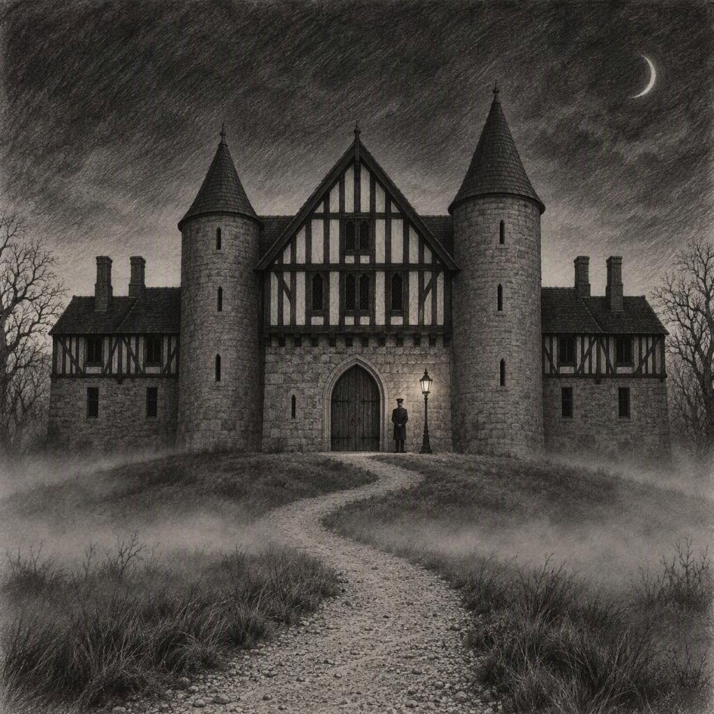
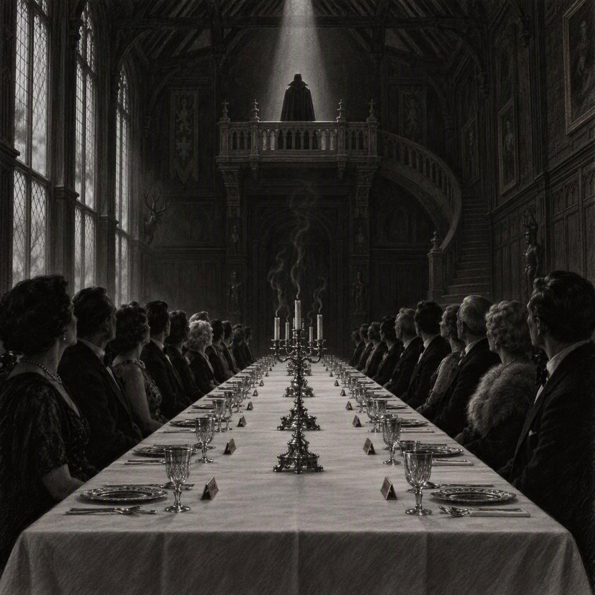
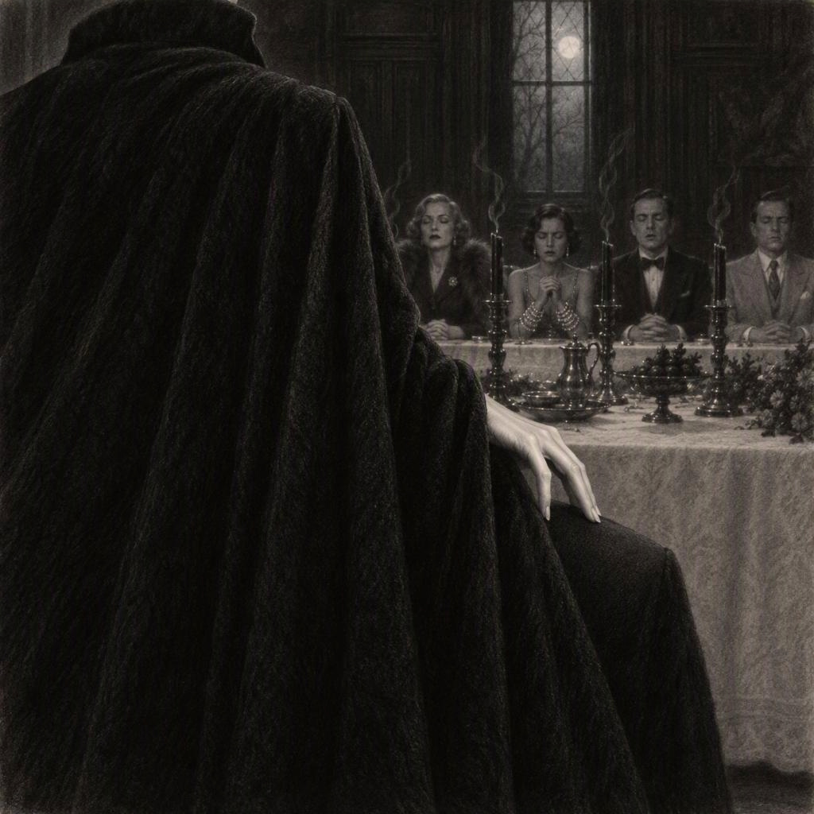
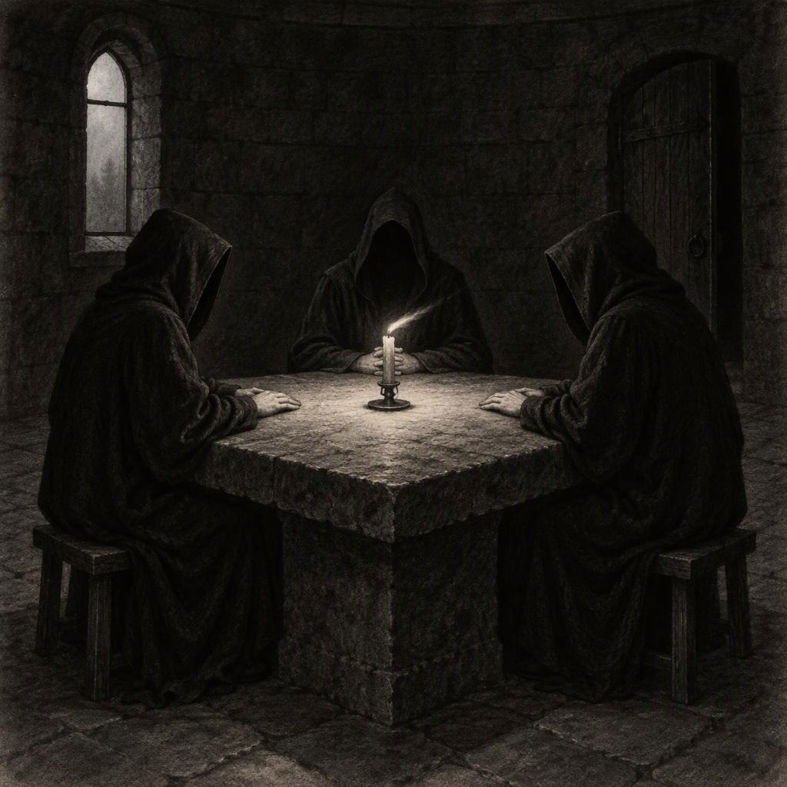

# Árulók – Halálos kastély

A Holdvári-kastélyban huszonkét régen elhunyt híresség játssza a halálos társasjátékot, és köztük árulók rejtőznek. A történet és a párbeszédek kitaláltak, a szereplők modorát ismert közszereplői vonásaik ihlették. A játékot Szerafin Barnabás, a kastély Játékmestere vezeti. Fekete köpenyt visel, lassan és ünnepélyesen beszél, olyan nyugalommal, amely rosszabb minden fenyegetésnél.

# 1. fejezet: Érkezés

A köd már a bekötőúton felbukkant, és a kapuig kísérte az érkezőket. Hideg volt, nyirkos és furcsán csendes, mintha tudná, hogy aki erre jár, az nem marad sokáig. A Holdvári-kastély a dombtetőn állt, szürke kőből épült, tornyokkal és fekete gerendázatú szárnyakkal. Az ablakok mögött sehol sem látszott fény. A kapu előtt kovácsoltvas lámpás égett, mellette egy fekete egyenruhás inas várt, mozdulatlanul, akár egy szobor.

Elsőként Kabos Gyula érkezett, a kalapját a kezében forgatva. Végignézett a tornyokon, aztán az inason.

– Kedves... kedves barátom, én azt hittem, ez a mennyország. De ez inkább egy gyanús vendéglőnek látszik.

– A tulajdonos mindent megmagyaráz, uram – felelte az inas, és meghajolt.

Utána sorban jöttek a többiek, és mindegyikük ugyanazt kérdezte magától: hol vagyok, és miért éppen én?

Latabár Kálmán a küszöbön megbotlott, aztán ügyesen kiegyenesedett, és vádlóan ránézett Kabosra, mintha az tehetne róla. – Régi trükk – mondta. – Csak most nincs közönség.

Hofi Géza hosszan nézte a kastélyt. – Szép hely – mondta. – Csak a kijáratot nem látom. Az mindig rossz jel.

Psota Irén körülnézett, és harsányan megkérdezte, hol a házigazda. Mivel senki sem válaszolt, megjegyezte, hogy vendéget így nem fogadnak, és ezt ők is meghallhatják odabent.

Puskás Ferenc a kapu mellett állt, és úgy méregette a kastélyt, mint aki idegen stadionba érkezett. – Itt nem mi játszunk hazai pályán – mondta halkan, aztán megveregette Latabár vállát, mintha az eredmény az ő pályaválasztásán múlna.

Neumann János megállt az udvar közepén, és megszámolta az ablakokat. – Huszonkettő – jelentette ki. – Huszonkét ablak, huszonkét vendég. Ez nem lehet véletlen.

Einstein mezítláb érkezett, a cipőjét a hóna alatt vitte. – Az idő itt furcsán viselkedik – mondta. – Mintha már régóta itt lennék, csak épp most vettem volna észre.

Salvador Dalí a bajuszát igazgatva szemlélte a bástyákat. – Dalí olvadó órákat festett – mondta ünnepélyesen. – Ez a kastély viszont kőből van. Dalí ezt személyes sértésnek veszi.

Freddie Mercury a küszöbön megállt, végignézett a tornyokon, és szélesen elmosolyodott. Megfogta a kapulámpás vaskarját, mintha mikrofonállvány volna, és hangosan felnevetett. – Drágáim, ez nem kastély, ez színpad! – mondta. – Csak a közönség késik. – Az inasnak kezet nyújtott, mintha a férfi lenne a fellépő.

Alfred Hitchcock lassan körbefordult a félhomályban. – Ennél jobb díszletet én sem rendelhettem volna – mondta, és elismerően bólintott.

Agatha Christie sokáig állt a kapuban. – Egy kastély, köd, huszonkét vendég – mondta csendesen. – Ezt a felállást ismerem. Ritkán végződik jól.

– Hideg van – mondta Marlene Dietrich, és összehúzta magán a bundáját. Más véleménye nem volt.

Louis de Funès a kapuban azonnal felháborodott. – Ez botrány! – kiáltotta az inasnak. – Maga tudja, ki vagyok én?

– Igen, uram – felelte az inas nyugodtan. – Itt mindenki tudja.

Louis Armstrong széles mosollyal köszönt mindenkit. – Üdv mindenkinek, kedveseim! Valaki tudja, hol a zenekar?

Orson Welles megkérdezte, mikor lesz vacsora, és hogy utána is lesz-e étkezés. A kabátja közben lecsúszott a válláról, de ő észre sem vette. Elizabeth Taylor ékszereinek csillogása elnyomta a kapulámpás fényét.

Marlon Brando leült a küszöbre. – Fáradt vagyok – mormolta. – Nem érdekel, hová megyünk.

Bud Spencer szó nélkül lépett be. Az ajtószárnyat úgy tolta odébb, mintha papírból lett volna, és mindenki hálásan elhallgatott. Maria Callas a küszöb előtt megállt, és várt. Az inas rájött, mit vár tőle, és megtapsolta. Callas ekkor lépett be.

Gábor Zsazsa körülnézett, és elmosolyodott. – Darling, ez nem a Ritz – mondta. – De legalább van benne egy kis dráma.

Bessenyei Ferenc a küszöbön megállt, és mély, színpadi hangon megszólalt: – Aki belép, annak előbb-utóbb ki is kell lépnie. – Senki sem válaszolt. Mindenki érezte, hogy ez most nem színdarab.

Utoljára Audrey Hepburn érkezett. Lassan jött, kissé fázósan, és mielőtt bármit mondott volna, felvette a földről Welles kabátját, és szó nélkül odanyújtotta neki. – Segíthetek a csomagokkal? – kérdezte halkan. Mindenki azonnal megkedvelte. Egy ilyen helyen ez vagy a legnagyobb előny, vagy a legnagyobb hiba.

## A kastély

Az inas becsukta mögöttük a kaput, és a zár hangja végigfutott az előcsarnokon.

– A vacsoráig szabadon járhatnak – mondta. – Minden ajtó nyitva áll, kivéve kettőt. – Meghajolt, és eltűnt egy faburkolat mögött, mintha ott sem lett volna.

Először szétszéledtek, aztán lassan mégis kisebb csoportokba rendeződtek, mert egyedül senki sem akart maradni.

A könyvtár a nyugati szárnyban volt, két emelet magas polcokkal és egy létrával, amelyet senki sem mert megmozdítani. Neumann egy pillantással végigmérte a falakat. – Tizenegyezer-valahány kötet – mondta. – Betűrendben. A betűrend a rend legegyszerűbb formája, és ezért a legmegnyugtatóbb. – Bessenyei a polc mellett állt, és hosszan, színpadi hangon szavalta a gerincek címeit, amíg el nem hallgatott, mert észrevette, hogy senki sem figyel rá.

Christie a „C" betűs polcnál állt meg. Végigsimított a gerinceken, és a keze megállt egy résnél. Egy kar szélességnyi üres hely volt a polcon, mintha valaki nemrég kivett volna onnan egy egész életművet.

– Érdekes – mondta csendesen, és tovább nem magyarázta.

A toronyszobában egy sárgaréz távcső állt az ablak előtt. Einstein belenézett, aztán derűsen felnevetett. – Köd – jelentette ki. – Csupa köd, és semmi más. A legszebb csillagászati látvány, amit valaha láttam. – Mercury a háta mögül lesett. – Drágám, ez nem távcső. Ez egy kémlelőnyílás a színfalak mögé. – Dalí a távcsövet a bajusza felé fordította, és kijelentette, hogy Dalí így is többet lát, mint a többiek.

A biliárdszobában zöld posztó feszült az asztalon, és a lámpa alatt a golyók elefántcsontszínűen ragyogtak. Armstrong fürgén felvette a dákót, és dúdolni kezdett a golyók fölött. Brando egy sarokban ült, és közömbösen nézte. Puskás kiválasztott egy golyót, megforgatta a tenyerén, és a földre ejtette, de nem pattant fel. – Jó labda – mondta elismerően. – Csak kicsit kemény.

A hosszú folyosón, a második emelet felé, festmények lógtak a falon. Sötét portrék voltak, régi ruhákban, fakó arcokkal. Hitchcock lassan haladt el előttük, és az utolsó előtt megállt.

– Nézzék csak – mondta halkan. – Mindegyik ugyanarra néz.

Odafordultak. A festett szemek mind a lépcsőkorlát felé figyeltek, a Nagyterem irányába. Senki sem szólt egy szót sem. Zsazsa és Taylor egy tükör előtt álltak, amely a folyosó végén lógott. – Darling, ez a tükör rosszul tükröz – mondta Zsazsa. – Túl sok árnyék van benne. – Taylor halkan egyetértett.

Callas az ajtó előtt, a lépcsőfordulóban megállt, és hosszan, tisztán kiadott egy hangot. A kastély falai visszaadták, és mindenki, aki hallotta, önkéntelenül elhallgatott.

Dietrich és Welles a lépcső mellett találkoztak. – Ön is a nyitható ajtókat keresi? – kérdezte Dietrich szárazon. – A zárt ajtókat – felelte Welles. – A zárt ajtókat mindig érdemes megnézni.

Az egyik a pincelépcső vasajtaja volt, a másik az északi toronyba vezető tölgyajtó. Kabos és Latabár egymás után nyomták le a kilincset, aztán egymásra néztek, mintha a másik tehetne arról, hogy az ajtó nem nyílik. Később többen is megpróbálták: de Funès kétszer is megrángatta, Psota Irén hangosan megjegyezte, hogy ilyen ajtót nem zárnak be vendég elől. Az ajtó nem engedett. A folyosó végén megkondult egy kis gong. A hangja nem volt hangos, mégis mindenki meghallotta.

– A vacsora tálalva – mondta az inas valahonnan a sötétből.

## A Nagyterem

A Nagyterem hosszú asztala mellett huszonkét szék állt. Mindegyik előtt kis aranyozott névtábla volt, rajta egy vendég neve. Leültek, és egy ideig senki sem szólalt meg. Csak egy óra ketyegett valahol a falban, vagy talán a szívük, ha még lett volna. Egyszerre kialudtak a gyertyák. A terem végében, az erkélyen egyetlen fénysugár villant fel, és a fényben egy magas, fekete köpenyes férfi állt. Sokáig nem szólt, csak nézte őket.

– Üdvözlöm önöket a Holdvári-kastélyban – szólalt meg végül mély, lassú hangon. – Szerafin Barnabás vagyok, a Játékmester.

– Önök mind meghaltak – folytatta, és a hangja még halkabb lett. – Ezt senki ne vegye sértésnek. Ez tény. De van, amit még nem tudnak: ez a hely a Feledés Előszobája. Aki ide kerül, azt még nem felejtette el a világ. A nevük él a filmekben, a lemezeken, a könyvekben, az emberek emlékezetében. Aki viszont innen kiesik, azt a világ nem csupán elveszíti. Elfelejti. A nevét kitörlik a hanglemezekről, a stáblistákról, a könyvek lapjairól, és senki sem fogja tudni, hogy valaha létezett.

Hofi halkan megszólalt. – Hát ez nagyon biztató.

– Nem szoktam viccelni – mondta a Játékmester. Hofi egy darabig nem szólt többet.

– A szabályok egyszerűek. Önök között hamarosan árulók rejtőznek. Kettő, három vagy négy. Hogy hányan vannak és kik, azt csak ők fogják tudni. Meg én. Minden éjszaka, amíg a többiek alszanak, az árulók konklávéra gyűlnek, és kiválasztanak egy ártatlant. Reggelre az illető széke üres lesz. A neve lekopik a névtábláról. Önök pedig lassan elfelejtik, hogy valaha is ott ült. A lefekvést minden este gongszó jelzi. Aki meghallja, annak kötelező visszavonulnia a szobájába.

Csend lett. Christie lassan felemelte a kezét, mint egy szerény tanuló.

– Szabad nyomozni?

– Önöknek nem is lesz más dolguk – felelte a Játékmester. – Az ártatlanok minden este a Kerekasztalnál szavaznak: akire a legtöbb szavazat érkezik, annak távoznia kell. Az első napon azonban nem lesz Kerekasztal. Az első éjszaka az árulóké.

A terem elnémult.

– Ha minden áruló eltűnik, az ártatlanok megosztoznak a fődíjon. Ha az árulók túlélik a játékot, az egész az övék.

– Mennyi a fődíj? – kérdezte Welles, aki elsőként érezte ki, mi a lényeg.

– Egyelőre nulla – mondta a Játékmester. – Nulla forint. Minden közösen megnyert játékkal gyarapodni fog.

– Tehát egyelőre nincs mit nyerni.

– Most nincs. – A Játékmester szünetet tartott. – De a játékokban pajzsot is lehet szerezni. A pajzs megvédi a viselőjét az éjszakai gyilkosság ellen. Aki pajzsot tart a kezében, azt az árulók nem érhetik el. A Kerekasztalnál viszont a pajzs semmit sem ér. Ott mindenki egyenlő, és mindenki ugyanúgy veszíthet.

Aztán lassan lejött az erkélyről. A köpenye súrolta a lépcsőfokokat, és ez volt az egyetlen hang a teremben.

– Most a kastély választ – mondta. – Én csak a kezemet kölcsönzöm hozzá.

Megállt az asztalfőnél, és sokáig nem szólt. Odakint a szél a tornyok között keringett.

– Kérem, hunyják le a szemüket. Mindannyian. Aki kinyitja a szemét, azt kikísérem a Feledés Kapuján, és az illetőre senki sem fog emlékezni.

Dalí résnyire kinyitotta az egyik szemét. Nem kukucskált, csak ellenőrizte, hogy a szeme tényleg csukva van.

– Azt hiszi, nem látom, mester? – kérdezte a Játékmester, anélkül, hogy felé nézett volna. – A Feledés Előszobájában a fél szem is nyitott szem.

Dalí gyorsan becsukta mindkettőt. A fénysugár eltűnt. A sötétben, a lehunyt szemhéjak mögött senki sem látott semmit, csak azt hallották, hogy valahol messze megkondul egy harang. Egyszer. Aztán még egyszer. Aztán megdobbantak a lépések.

Lassúak voltak, súlyosak és egyenletesek. A Játékmester körbejárta az asztalt, az egyik oldalon, aztán a másikon. Néha megállt, és a megállások hosszabbak voltak, mint kellett volna. Mindenki hallotta a köpeny suhogását, és mindenki érezte, ahogy a levegő megmozdul a háta mögött.

Kabos ajka hangtalanul mozgott, mintha imádkozna. Taylor ékszerei finoman csilingeltek, ahogy remegett a keze. Armstrong, aki egész este mosolygott, most először volt komoly. Dietrich mozdulatlanul ült, akár egy szobor. Latabár a saját lélegzetét hallgatta, pedig tudta, hogy már nem kellene lélegeznie.

A léptek valaki mögött megálltak. Hosszan. Olyan hosszan, hogy az illető már azt hitte, őt fogják kivonszolni a teremből. Aztán hideg ujj érintette a vállát, könnyedén, szinte gyengéden. Az asztal túlsó végén valaki élesen beszívta a levegőt, és a léptek továbbmentek.

Később megint megálltak. Aztán újra. Hogy hányszor, azt a vendégek közül senki sem tudta biztosan, mert aki számolt, az elvesztette a fonalat. Ez a krónika sem árulja el. Egyelőre. Végül a lépések visszatértek az asztalfőhöz, ahonnan elindultak. Olyan csend lett, hogy a fal túloldalán hallani lehetett, ahogy a köd mozog.

– Nyissák ki a szemüket.

A gyertyák újra égtek, és a Játékmester az erkélyen állt, mintha el sem mozdult volna.

– Megtörtént – mondta. – Az árulók már tudják, mi a dolguk. Egymást majd éjfélkor ismerik meg. Önök pedig most kezdenek félni. Jó étvágyat kívánok.

Huszonkét ember nézett körül úgy, ahogy csak az néz, aki most tudta meg, hogy néhányan közülük hazudni fognak neki. Valaki közülük már tudta, hogy többé senkire sem fog őszintén nézni. A Játékmester addigra eltűnt a fényből. Welles mégis nekilátott a vacsorának, és kijelentette, hogy az étel az egyetlen, ami a halál után sem csalódás.

## Gyanú az asztalnál

Egy ideig csak a kések és a villák kocogtak a tányérokon. Senki sem mert a szomszédjára nézni, mégis mindenki ezt tette, félszemmel, a pohara pereme fölött. Hofi törte meg a csendet. Letette a kanalát, végignézett az asztalon, és olyan komoly arccal szólalt meg, mintha ítéletet hirdetne.

– Jó, akkor most jelentkezzen, aki a gyilkos. Ígérem, nem bántjuk. Csak a leves ne hűljön ki.

Latabár túl hangosan felnevetett, aztán rögtön el is hallgatott, mintha ő maga is észrevette volna, mennyire gyanús.

– Ne nevessen így, Kálmán – mondta Psota Irén, és a villájával rámutatott. – Aki így nevet, annak oka van rá.

– Nekem mindig ilyen a nevetésem – felelte Latabár sértődötten. – Egész életemben ezen derült mindenki.

Mercury hátradőlt a székén, és színpadiasan felemelte a kezét.

– Én vagyok az, drágáim – mondta. – De csak színpadon, és csak ha a közönség kéri.

– Jaj, kedves barátom, ezt ne mondja! – fogta a fejét Kabos.

Zsazsa Kabos felé fordult, és kedvesen a karjára tette a kezét.

– Darling, maga gyilkos?

– Én? – Kabos felállt, aztán megint leült, és a kalapját kereste, pedig nem is volt nála. – Kedves barátom, én még a legyet is... a nagymamám is mindig... nézze, én soha...

– Nem hangzik meggyőzően.

– Hát éppen ezért vagyok ártatlan! – kiáltott fel Kabos. – Egy gyilkos jobban hazudna!

Az asztal egyszerre felnevetett, és ez jót tett mindenkinek, bár a nevetés gyorsan abbamaradt.

Bud Spencer addig szótlanul evett. Most letette a kanalát. – Aki eszik, az nem gyilkol – mondta lassan. – Legalábbis nem egyszerre.

– Akkor önnek holnap lesz a legjobb alibije – mondta Armstrong, és halkan, szinte dúdolva nevetett.

Amikor lecsillapodtak, megindult a nyomozás. Először halkan, aztán egyre hangosabban.

– Valaki megállt a hátam mögött – mondta Callas, és a nyakához kapott. – Hosszan, a jobb oldalamon. Éreztem a lélegzetét.

– Én az asztal túlsó végén hallottam, hogy valaki élesen beszívja a levegőt – mondta Dietrich. – Amikor a léptek először megálltak, hosszan.

– Nekem a szék mögül mintha suttogtak volna – jegyezte meg Einstein elgondolkodva. – Bár lehet, hogy a saját fejemben.

– Én a falból hallottam valamit – mondta Dalí. – A bajuszom is hallotta, és a bajusz sosem téved.

Puskás a bal oldalról jövő sercegést említette, Welles szerint viszont egyáltalán nem volt zaj, csak egy sóhaj. Bessenyei hosszan szólt arról, hogy a sötétben a hallás élesebb, mint a látás, majd elvesztette a fonalat, és az asztalra nézett.

– A sóhaj megkönnyebbülés – jelentette ki Neumann, mint aki tételt mond ki. – Aki sóhajt, annak elmúlt valami.

– Vagy szorongás – vetette ellen Einstein. – Az ember ugyanúgy sóhajt, ha valami elmúlt, mint ha valami még csak most jön.

– Remek – mondta Hofi. – Tehát aki sóhajtott, az vagy ártatlan, vagy áruló. Ez sokat segít.

Christie egy szót sem szólt. Egy kis noteszba írt valamit, aztán halkan megkérdezte Hitchcocktól:

– Ön szerint ki szólalt meg elsőként a gyertyák kialvása után?

Hitchcock elégedetten megvonta a vállát.

– Az a kérdés, ki nem szólalt meg.

Dalí a bajuszát igazgatta. – Dalí ilyenkor mindig magába néz – jelentette ki. – Dalí soha nem csinált mást.

– Akkor ezt jegyezzük fel alapállapotnak – mondta Christie, és beírta a noteszába. – Holnap reggel azt kell nézni, ki néz másképp, mint ma este.

– Én azt mondom, a gyanús az, aki utoljára érkezett – szólt közbe Welles, és a kabátját igazgatta. – A színpadon is az viszi el az előadást, aki késve lép be.

Mindenki Hepburn felé fordult. Ő zavartan elmosolyodott. – Elnézést, hogy késtem – mondta halkan. – Legközelebb korábban indulok.

– Szűkítsük a kört – mondta Neumann, és közben egy szalvétát terített maga elé, és vonalakat húzott rá. – Javaslom a módszeres eljárást. Mindenki megmondja, hol ült, mit hallott, és milyen irányból. Ha a hangok összevethetők, szűkíthetjük a kört. Kiindulásnak itt van: kettő, három vagy négy áruló, huszonkét vendég. Bárkiről, aki mellettem ül, nagyjából egy a hétből az esély, hogy hazudik.

– Egy a hétből! – fakadt ki de Funès. – Szűkítse, szűkítse, én már szűkítettem! Maga! – Rámutatott Dietrichre, aztán Taylorra. – Meg maga is gyanús! Az előbb még nevetett, most meg az ékszereit számolgatja!

– Ha ideges vagyok, mindig megszámolom őket, drágám – felelte Taylor. – Az más.

Dietrich hűvösen hozzátette: – Ön az előbb még ordított, most meg a levesre néz. Ez is megváltozott viselkedés.

De Funès kinyitotta a száját, aztán becsukta, ami nála ritkán fordult elő. A következő elszólás Latabártól jött. Még mindig sértődötten ült a sarokban, és a kenyerét morzsolgatta.

– Én ugyan nem látok semmit – mondta. – Mi hárman ültünk a sarokban, Kabos, Puskás meg én, és mi egyáltalán nem hallottunk semmit.

Csend lett. Aztán de Funès felpattant.

– Hárman! Azt mondta, hogy hárman! A Játékmester azt mondta, kettő, három vagy négy áruló van, és ő éppen a hármat mondta!

– De hát hárman ültünk abban a sarokban, az istenért! – kiáltott Latabár. – Én, Kabos meg Puskás!

– Pontosan ez az, amit egy gyilkos mondana – jelentette ki Psota Irén. – Okos, kézenfekvő magyarázat.

– Én ott ültem mellette, igazat mond – szólt közbe Puskás. – Maguknak nem a számokkal van bajuk, hanem a nevetésével.

– Köszönöm, Öcsi – mondta Latabár, és egy kicsit megenyhült.

– A számok olyanok, mint az olvadó órák – mondta Dalí. – Bárkire rá lehet csúsztatni őket.

Kabos ekkor megpróbált segíteni Latabárnak, és ez rosszul sült el.

– Hagyják már békén, nézzék meg, szegény mennyire... Mi, árulók... akarom mondani, ártatlanok! Mi, ártatlanok!

Az asztalnál mindenki megdermedt. Kabos a mellére szorította a nem létező kalapját.

– Ez volt a legrövidebb beismerő vallomás az emberiség történetében – mondta Hofi, és hátradőlt a székén. – És a leves még meleg is.

Utána mindenki egyszerre kiabált. De Funès már a székén állt, Psota Irén az ujjain számolt, Callas az ajtó felé fordította a fejét, mintha menekülni akarna. Kabos két kézzel integetett:

– Félreértés, félreértés!

Aztán hirtelen elhallgatott, és csendesen annyit mondott:

– Én tényleg nem vagyok az.

Hepburn volt az, aki halkan megszólalt, és azonnal elcsendesedtek.

– Mi mind félünk – mondta. – Az nem bűn. Én is félek.

Az asztal körül többen bólintottak. Zsazsa megfogta Hepburn kezét, Kabos pedig hálásan nézett Hepburnre.

– Ma nincs szavazás – emlékeztette őket Christie. – A Játékmester világosan megmondta. Egyelőre csak gyűjtsük a tényeket, és holnap mérlegeljük őket.

– Pont ez a baj – morogta Puskás. – Egy egész éjszakát hagyunk nekik.

Senki sem felelt. Brando az asztal végén közömbösen tolta odébb a tányérját. – Engem nem érdekel – mormolta. – Én aludni akarok.

Ekkor mély, öblös gongszó rezdült végig a kastélyon. Egyszer, aztán másodszor, aztán harmadszor. A gyertyák lángja meghajlott, és a Nagyterem ajtaja magától kinyílt.

– A lefekvés ideje – szólt a Játékmester hangja valahonnan a falak mélyéből. – A gong szavára mindenki hallgat. Kérem, vonuljanak vissza a szobáikba.

Senki sem mozdult. Mindenki arra gondolt, hogy aki most feláll, talán utoljára látja ezt az asztalt ebben a társaságban. Puskás állt fel elsőként, mert parancs az parancs, a többiek pedig lassan követték.

## Az első éjszaka

A szobák felé vezető folyosón suttogva beszélgettek, mert a kastély falai minden hangot visszaverték.

– Én ma nem alszom – mondta Hofi. – Aki alszik, az olyan, mintha a halálra jelentkezne.

– Én bezárom az ajtót – mondta Kabos –, hiszek benne, hogy az megvéd.

– Jó éjszakát – morogta Brando, és megvonta a vállát.

– Én dúdolgatok egy kicsit, ha nem bánják – mondta Mercury. – Aki hallja, tudni fogja, hogy még itt vagyok. Gyanúsnak ez sem gyanúsabb, mint a némaság.

– Jó éjszakát – mondta Hepburn halkan. – Vigyázzunk egymásra.

Callas az ajtajában megállt, végignézett a folyosón, és annyit mondott: – Ciao. – Aztán becsukta maga mögött az ajtót.

Egymás után csukódtak az ajtók, és kattantak a zárak. A kastélyra olyan csend nehezedett, amilyet csak az ismer, aki már várt valamire, ami biztosan megtörténik.

## Az első konklávé

Éjfélkor, amikor a folyosók gyertyái is kialudtak, az északi toronyba egymás után érkeztek az árulók. Csuklyát viseltek, és mindegyikük tudta, hogy van még legalább egy társa, csak azt nem, hogy ki az. Az egész estét azzal töltötték, hogy a többiek között hazudtak, és közben minden arcban a társukat keresték. Az Első megállt a kőasztalnál, ahol egyetlen gyertya égett, és vállat húzott a hidegben. Aztán lépések hallatszottak a lépcsőn. A Második belépett, és az ajtóban megtorpant. Egy pillanatig egyikük sem mozdult. Aztán mindketten lehajtották a csuklyájukat. Ez a krónika az arcokról semmit sem árul el.

– Maga?! – suttogta az egyik, és a hangjában több volt az öröm, mint a meglepetés.

– Maga is?! – felelte a másik, és halkan, megkönnyebbülten felnevetett. – Egész este azt találgattam, ki lehet a társam. Magát is végignéztem, és semmit sem vettem észre magán.

– Én is! Ültem a vacsoránál, és közben azt vártam, hogy végre éjfél legyen...

A lépcsőn újabb lépések hallatszottak. A két árulónak egyszerre állt meg a szívverése, aztán a Harmadik is megjelent az ajtóban, szintén csuklyában. Lehajtotta a kámzsát, és hárman nézték egymást, aztán egymás kezét fogták meg, mint akik régen nem látták egymást, pedig alig néhány órája ültek ugyanazon az asztalon.

– Hárman vagyunk – mondta a Harmadik.

– Hárman vagyunk – ismételte az Első, mintha csak ki akarná próbálni, milyen érzés kimondani.

Hárman voltak, bár a többiek ezt még nem tudhatták. Újra a fejükre húzták a csuklyát, leültek a kőasztalhoz, és a gyertya fényében megint csak suttogó hangok maradtak.

– A konklávé megkezdődhet – mondta az Első.

– Az első éjszaka a legkönnyebb – felelte a Második. – Még senki sem gyanakszik senkire. De holnaptól minden hang számít.

– Akkor ki legyen? – kérdezte a Harmadik.

Sokáig nem szólt senki. A gyertya lángja meghajolt, mintha valaki a háttérben sóhajtott volna.

– Olyasvalaki – mondta az Első –, akit nem fognak sokáig keresni.

– Vagy olyasvalaki – mondta a Második –, akinek az eltűnése mindenkit megrémít. – Kis szünetet tartott. – Én ezt választanám. Egy megrémült társaság hibázik.

– Egy megrémült társaság összetartani is tud – vetette ellen az Első, de nem emelte fel a hangját. A Második nem vitatkozott tovább.

A Harmadik az ujja hegyével a kőasztalt kocogtatta. Aztán halkan kimondott egy nevet. A másik kettő bólintott. A konklávé döntött.

– Holnap reggel egy üres széket fogunk nézni – mondta az Első. – És pont olyan arcot kell vágnunk, mint a többieknek.

Lent, a hálószobákban a többiek aludtak, vagy úgy tettek, mintha aludnának. Az egyik szobában valaki a mennyezetet nézte, és minden zajra összerezzent, a toronyból leszűrődő hangokra is. Mindegyikük tudta, hogy reggelre eggyel kevesebben lesznek, mert a szabály ezt kimondta. Azt viszont csak a három áruló tudta, hogy ki lesz az.
