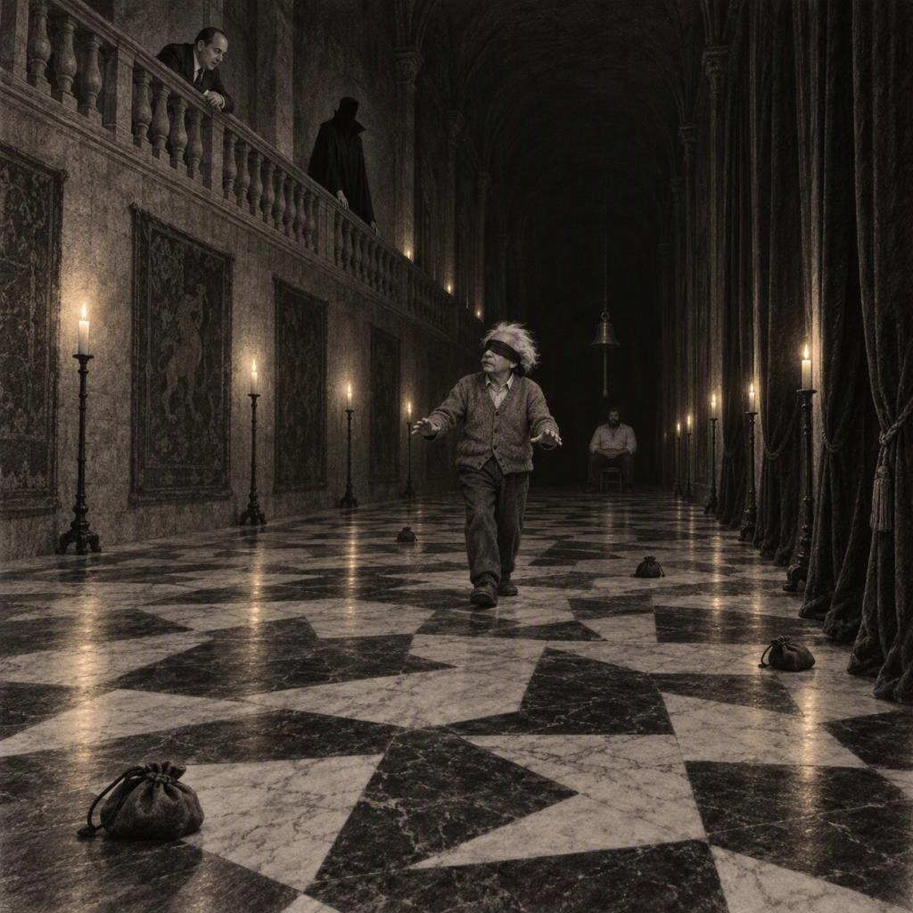
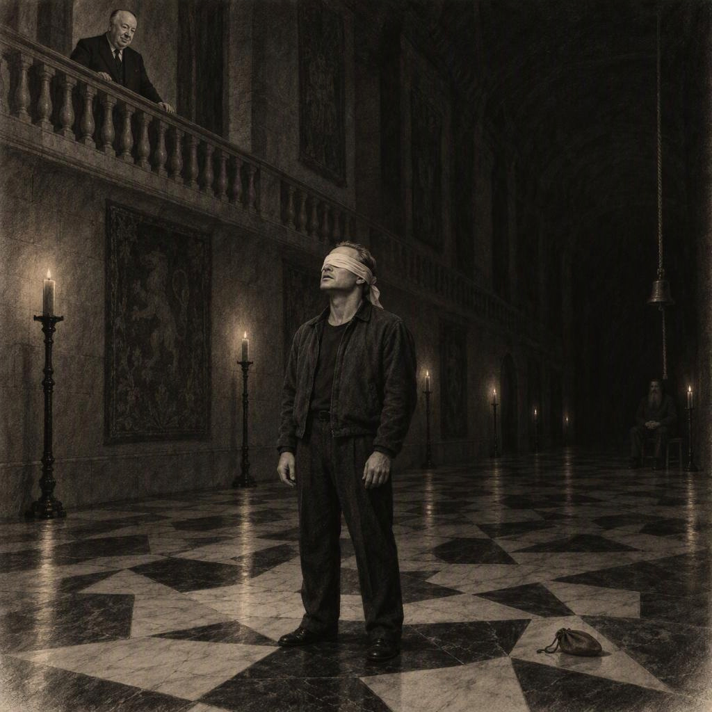
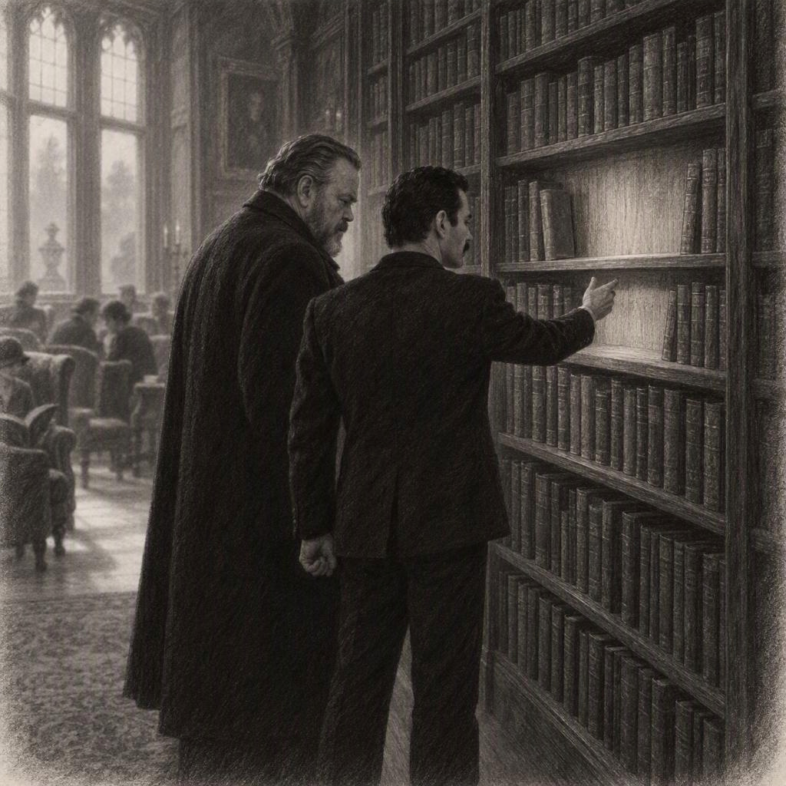
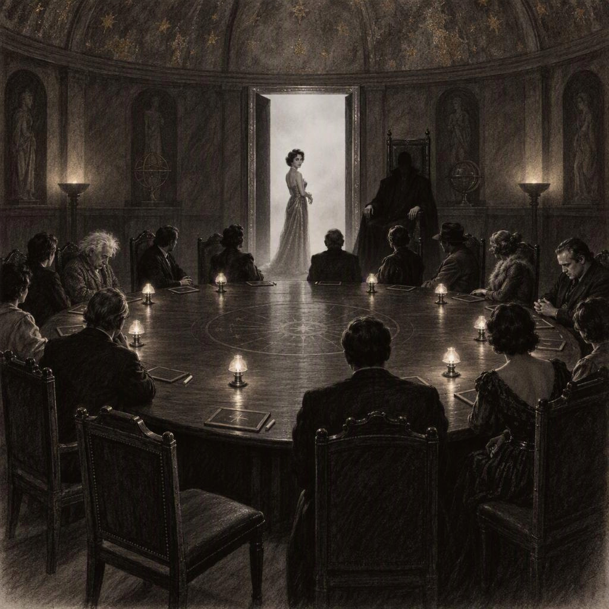

# 5. fejezet: A vakfolyosó

## A reggeli

A gong hétkor szólalt meg, és a Nagyterem előtt már állt valaki. Bud Spencer volt az, hátát a falnak vetve, összefont karral, mint aki nem a reggelire vár, hanem arra, hogy elteljen az idő. Mercury és Zsazsa érkezett utána, szinte egyszerre, és egyikük sem szólt.

– Hányan vannak bent? – kérdezte Mercury halkan.

– Még senki – felelte Bud Spencer. – Mi vagyunk az elsők.

– Az elsőnek lenni sosem jó – mondta Zsazsa. – Aki elsőnek érkezik, annak kell végignéznie, kik jönnek be az ajtón, és kik nem.

Bementek. A Nagyteremben a gyertyák még égtek, pedig odakint már világos volt. A hosszú asztalon a terítékek sorban álltak, a névtáblák a tányérok előtt, és senki sem akarta megszámolni őket.

Mercury némán mozgatta az ajkát, és magában sorolta a neveket. – Ma már csak fejből – mondta.

A második csoport egyben érkezett. Hitchcock jött elöl, Dalí mellette, mögöttük Kabos és Puskás. Kabos Puskás karjába kapaszkodott, és közben hangtalanul mozgott a szája.

– Ne számolj, Gyula – mondta Puskás, és kihúzta neki a széket. – Ülj le, a többit úgyis meglátjuk.

– De ha nem számolok, nem tudom, hányan vagyunk.

– Akkor is annyian vagyunk, mintha számolnál.

Hitchcock megállt a szék mögött, és az ajtó felé fordult. – Reggel mindig az ajtót kell nézni – mondta. – A szék nem mond semmit. Az ajtó előbb-utóbb mond.

– Maga ezt miért mondja? – kérdezte Dalí.

– Mert az ajtón át az érkezik, akit várunk. Vagy nem érkezik – felelte Hitchcock, és leült.

Neumann a harmadik csoporttal érkezett, Brandóval és Callasszal. A küszöbön megállt, és az ajka mozdult. Aztán beljebb lépett, és a szalvétáját simította.

– Tízen vagyunk – mondta. – Tizenhatan feküdtünk le, tizenöten ülünk majd az asztalnál. Egyet kivontunk, csak még nem tudjuk, kit. A kivonás lassan elvesz minden izgalmat az emberből.

– Magából? – kérdezte Callas.

– Belőlem ritkán vesz el. – Neumann a tányérja mellé igazította a kanalat. – Másokból igen.

Brando leült, és a kezére támasztotta a fejét. – Ma ki fog magyarázni nekem valamit? – kérdezte. – Szeretném tudni előre, hogy felkészüljek.

– Magát nem kell magyarázni – mondta Callas. – Magát kérdezni kell.

– És erre kérdéssel felelek – mondta Brando. – Pontosan.

Callas szája sarka megrándult, aztán újra komor lett. A negyedik csoport hosszabb ideig késett, mint az előzőek. Hepburn jött elöl, mögötte Welles, Taylor és Einstein. Hepburn az ajtóban megállt, és végigfuttatta a szemét a székeken, ahogy a gyerek számolja a testvéreit, mielőtt elalszik. Aztán fellélegzett.

– Maguk is itt vannak – mondta. – Nem is tudom, miért remegek még mindig.

– Mert mi mind remegünk – felelte Einstein halkan. – Csak nem mindenki mutatja.

Welles nem szólt. Leült a helyére, a karjait az asztalra tette, és az ajtót nézte. Taylor mellé ült, és a karperecét forgatta, de nem a tányért nézte, hanem Hepburnt. Hofi érkezett utolsónak, és egyedül. A küszöbön megállt, mintha nem bízna a saját lábában, és csendben végigszámolta a székeket. Az ajka sem mozdult, csak a szeme ugrált szék és szék között.

– Tizenöt – mondta aztán a levegőnek. – Ennyi volt.

– Maga ezt tegnap is így kezdte? – kérdezte Zsazsa.

– Tegnap még nem voltam ilyen jó benne.

Leült, és az asztal közepére nézett, ahol a kancsó állt. Ekkor vették észre mindannyian, hogy az asztal végén egy teríték érintetlen maradt: a tányér mellett nem állt névtábla, és a szék egy fokkal hátrébb volt tolva a többinél, mintha valaki épp most kelt volna fel belőle.

– Ferenc – mondta Mercury halkan.

A Játékmester a kandalló mellett állt, mintha mindvégig ott lett volna. A szürke ruhája csak egy árnyalattal volt sötétebb a falnál, és a hangja halkan indult, mint mindig.

– Bessenyei Ferenc ma éjjel elfelejtetett – mondta Szerafin Barnabás. – A neve lekopott a névtábláról, és a nevével együtt elmúlik az is, amit magával vitt. A fődíj egymillió-nyolcszázhetvenezer forint. Pajzsa senkinek sincs. Ma délelőtt tíz órakor, a Nyugati Galériában, megtudják, mit ér a bizalom.

Szünetet tartott.

– Jó étvágyat kívánok.

Senki sem nyúlt az ételhez. Neumann akkor szólalt meg, amikor a gyertyák lángja már kétszer is meglibbent.

– Tisztázzunk valamit – mondta. – Nem vád, adat. Marlene Dietrich Welles úrnak azt mondta, a szalonban valaki élesen beszívta a levegőt, a kör túloldalán. Nekünk ez ma az egyetlen nyom, amelyet Dietrich halála után is ismerünk. Nézzük meg, kik ültek azon az oldalon.

– Hat-hét ember – mondta Taylor.

– Hat-hét. Ez a szám nem sok és nem kevés. – Neumann a kezén kezdte számolni. – Kabos úr, Puskás úr, Brando úr, Callas asszony, Dalí. Öten. A hatodik...

– Én is ott ültem, Gyula mellett – szólt Hepburn halkan, mielőtt Neumann folytathatta volna. – Jobban szeretném, ha ezt tőlem hallanák, mint hogy azon tűnődjenek, miért nem mondom.

– Köszönöm – mondta Neumann. – Ez hasznos.

– Én mellette ültem? – kérdezte Kabos. – Mellettem ült? Ki ült mellettem? Nem tudom. Valaki mondta, hogy...

– Gyula – szólt Puskás. – Én ültem melletted. Én, ha tudni akarod.

– Akkor ki szívott levegőt? – kérdezte Kabos ártatlanul. – Én nem. Vagy... én igen, mindenki szív levegőt, nem?

– Mindenki – mondta Hofi. – Az a dolgunk.

Neumann a hüvelykujjával megkocogtatta az asztal szélét. – A levegővétel nem elég. Dietrich azt is mondta, hogy az első éjszaka ugyanaz a hang volt. Ketten hallották: Dietrich és Welles. Most már csak Welles.

Welles nem szólt, csak bólintott.

– És ott a lista – szólt közbe Mercury. – Bessenyei listája. Bud Spencer, Callas, Dalí, Puskás... – Elakadt.

– Einstein – mondta Hofi.

Einstein felemelte a fejét. – Egy halott mondata nem bizonyíték – mondta. – Őt már nem kérdezhetjük meg, mire gondolt, amikor kimondta.

– Csakhogy ő nincs itt, a listája viszont igen – mondta Hofi. – És két lehetőség van, mindkettő rossz. Ha azért ölték meg, mert gyilkos volt a listán, akkor a listán gyilkos ül. Ha azért, mert nem volt rajta gyilkos, akkor a gyilkosok azt akarják, hogy a listát nézzük, és a listán ülők legyenek a gyanúsak.

– És melyik igaz? – kérdezte Taylor.

– Ha tudnám, nem itt ülnék, hanem ott. – Hofi a Játékmester felé intett a fejével.

– Mindkét feltevés ugyanazt az adatot magyarázza – mondta Neumann. – Ami két ellentétes magyarázatot is elbír, az egyiket sem bizonyítja.

– Dalí a listán van – jelentette ki Dalí. – Dalí tudomásul veszi, hogy akár így, akár úgy, rá fognak nézni.

– A lista kérdés, nem válasz – mondta Einstein. – Ezt tegnap is mondták, és ma is igaz.

– Én csak annyit mondok – szólt Callas –, hogy engem Bessenyei az öt név közé sorolt, és ebből nem lehet sem érvet, sem bizonyítékot csinálni. Én nem vagyok csendes. Én vagyok az, aki nem kiabál.

– Ez a különbség nagyon finom – mondta Taylor.

– Én a finom különbségekből élek – felelte Callas.

Mercury nagy levegőt vett, és sorolni kezdte, mint minden reggel: – Louis, Louis, Kálmán, Agatha, Irén, Marlene... – Megállt. – Ferenc.

– Én is Ferenc vagyok – szólt Puskás.

– Melyik?

– Aki nincs itt, az volt az első.

Mercury bólintott, és elhallgatott. A névsor most hosszabb volt, mint tegnap, és minden név után hosszabb csend következett.

## A Vakfolyosó

A Nyugati Galéria a kastély leghosszabb terme volt, és a legsötétebb. A padlója fekete és fehér márványlapokból állt, szabálytalan mintában, mintha egy sakktáblát összekevertek volna, és a lapok között alig látszott a vonal. Az ablakokat nehéz bársony takarta. A falak mentén gyertyák égtek, de olyan ritkán, hogy a fényük nem érte el egymást, a terem végében pedig, ahol a folyosó kiszélesedett, egyetlen harang függött vastag kötélen. Mellette egy szék állt.

A Játékmester az erkélyen várta őket, amely a terem hosszanti oldalán futott, és a korlát mögül mindent be lehetett látni.

– Tizenöt vendég, hét pár és egy Hallgató – mondta. – A sorsot az urna dönti el.

A szolgálatos inas ezüsttálcán hozta az urnát, és sorban húzatott velük pecsétes cédulákat. Neumann kérte, hogy előbb ellenőrizhesse, nincs-e kettős cédula vagy üres, és a Játékmester egy intéssel megengedte. Neumann végigkereste az urna alját, kiszámolta a cédulákat, aztán bólintott. – Tizenöt. Rendben.

Bud Spencer húzta a Hallgató cédulát. Megnézte, és szó nélkül felmutatta.

– Maga a harangnál ül – mondta a Játékmester. – Nem szólhat, és nem mozdulhat. Ez a dolga.

– Értem – mondta Bud Spencer. Nem kérdezett semmit, és ez tényleg ő volt: odament a székhez, leült, és az ölébe tette a kezét.

– Minden pár egyik tagja a Vak – folytatta a Játékmester. – Bekötik a szemét, és végigmegy a folyosón a harangig. A másik a Hang. Az erkélyről lát mindent, és csak a szavával segíthet. A padlón erszények vannak, egyenként harmincezer forint. Amit a Vak megtalál és felvesz, az a fődíjba kerül. De a fekete márvány tud valamit: aki fekete lapra lép, annál megkondul a harang. Ilyenkor tízezer forint elvész.

– Minden harang tízezer – ismételte Neumann. – Fehér márványon biztonságos, feketén nem. A fekete és a fehér elosztásában van szabályszerűség?

– Nincs – felelte a Játékmester. – A többiek a lépcsőházban várnak, senki sem látja előre a másik útját. Így mindenki ugyanazokkal az esélyekkel indul. – Szünetet tartott. – A legtöbb nettót hozó pár pajzsot kap. Ők döntik el, ki viseli.

A többiek a lépcsőházban vártak, a Galéria ajtaja mögött. Ide csak a hangok szűrődtek át, a lépések, a harang és a hangok. Elsőnek Neumann és Einstein ment. Einstein kötötte be a saját szemét, aztán megállt a küszöbön. Neumann felment az erkélyre, és a korlátra támaszkodott.

– Három lépés előre – mondta. – Fehér, fehér, fehér. Utána egy kicsit balra.

– Mennyi az a kicsi? – kérdezte Einstein.

– Fél lépés.

– Fél lépéssel én nem tudok mit kezdeni. A lábam egész lépésekben gondolkodik.

A lépcsőházban valaki felnevetett, aztán gyorsan elhallgatott. Az ajtón át hallani lehetett, ahogy Einstein óvatosan, kis lépésekkel megy, és Neumann hangja egyenletesen, számolva követi: – Négy. Öt. Hat. Kicsit jobbra. Most.

A harang egyszer megkondult. Mindenki a lépcsőházban megmerevedett.

– Ez az enyém volt – hallatszott Einstein hangja. – Mondtam, hogy egész lépésekben gondolkodom.

– Három erszény, egy harang – jelentette ki Neumann a lépcsőházba, miután kijöttek, mintha jegyzőkönyvet vezetne. – Nyolcvanezer.

Hofi és Zsazsa következett. Zsazsa kötötte be a szemét, két kézzel, nagy műgonddal, hogy a frizurája ne sérüljön, és a küszöbön megállt. – Drágám – mondta Hofinak, aki már az erkélyről nézett le rá –, én már követtem férfi hangját sötétben, de eddig mindig égett mellette egy lámpa.

– Akkor most teljesen új élmény lesz, darling – mondta Hofi. – Három lépés előre. És balra tessék.

– Balra?

– Balra. A másik balra.

A harang megkondult.

– Ez nem én voltam – mondta Hofi komolyan. – A harang csak megállapította, hová lépett.

– Maga mondta, hogy balra!

– Én azt mondtam, hogy balra. Maga jobbra ment, mert az ösztöne mindig a másik irányba húzza.

Zsazsa kivett egy erszényt a padlóról, felmutatta, és fennhangon folytatta: – Ezt nem a maga hangja találta meg, drágám, az ösztönöm.

A harang még egyszer megkondult, tompán, mintha ő is nevetne. Hofi arca közben a legkomolyabb maradt, és ez volt benne a legjobb. Hepburn és Taylor ment harmadikként. Taylor bekötötte a szemét, és szótlanul állt a küszöbön, mint aki nem akar elsőnek megszólalni. Hepburn felment az erkélyre. Halkan beszélt, olyan halkan, hogy a lépcsőházban nem hallották, csak a ritmusát.

– Három lépés előre, Elizabeth – mondta. – Ne siessen.

Taylor elindult. Az első kettő jól sikerült, aztán Hepburn hangja megtört, mintha a gondosságtól bizonytalanodna el. – Most balra. Egy lépést.

A harang megkondult.

– Biztos, hogy balra volt? – kérdezte Taylor, és az arca a kötés alatt megfeszült.

– Azt hittem... – mondta Hepburn. – Bocsásson meg. Innen fentről, a gyertyafényben, alig látom, melyik fekete.

– Maga mondta, hogy balra – mondta Taylor.

– Tudom. Bocsásson meg.

A harang másodszor kondult. Harmadszor is. A lépcsőházban Zsazsa összenézett Callasszal.

– Elizabeth – mondta Hepburn, és a hangja most egészen elfúlt –, olyan szörnyű vagyok. Az egész az én hibám.

– Nem tudom – mondta Taylor. – Éppen azon gondolkodom, hogy ez most a maga hibája volt, vagy az enyém.

Két erszényt vett fel, három harang. A lépcsőházban Hepburn odarohant hozzá, és megfogta a karját. – Nem tudtam jól vezetni.

– Kettő és három – mondta Neumann az ajtóból. – Harmincezer.

Hitchcock és Brando következett. Brando kötötte be a szemét, aztán hosszasan állt, mintha a sötétben is látni akarna valamit. Hitchcock felment az erkélyre, és a korlátra tette mindkét kezét. A hangja olyan volt, mintha filmet vezényelne.

– Két lépés előre – mondta. – Ne siessen. Egy hang az, amiből a félelem készül.

Brando megtette a két lépést, és megállt.

– Most jobbra – mondta Hitchcock.

– Miért jobbra? – kérdezte Brando. – Az előbb még előre volt.

– Előre volt. Most jobbra.

– Miért jobbra?

– Mert ott van a pénz.

– Honnan tudja, hogy ott van?

– Mert én látom.

– Akkor menjen maga – mondta Brando. Aztán egy pillanatig habozott, és olyan nagyot lépett, hogy a harang azonnal megkondult. – Hoppá.

– Ez nem lépés volt, hanem előadás – mondta Hitchcock.

– A jó rendező instruál – mondta Brando. – Maga csak annyit mondott: jobbra.

A lépcsőházban még Taylor is elmosolyodott. Hitchcock végül három erszényhez vezette Brandót, és a harang összesen csak kétszer kondult. Mercury és Dalí a következő pár volt. Dalí felemelt fejjel állt a küszöbön, és maga kötötte a szemére a kendőt.

– Dalí nem téved el – mondta. – Dalí a sötétben is látja a saját bajuszát.

Mercury az erkélyről nem szavakkal vezette, hanem hangokkal: egy mély hümmögéssel, ha egyenesen kellett mennie, egy magasabbal, ha jobbra, és szaggatott kettővel, ha meg kellett állnia. Dalí elindult, és a lépéseiben nem volt semmi bizonytalanság, mintha ismerné a padlót. A harang egyszer szólalt meg, akkor, amikor Dalí egy pillanatra megállt, és hangosan ezt mondta: – Itt a gondolat balra tér.

– Jobbra – hümmögte Mercury.

– A gondolat jobbra tér – javította ki Dalí, és tovább lépett.

Három erszény, egy harang. Nyolcvanezer. Callas és Welles jött hatodikként. Callas az erkélyről nem beszélt, ritmust tartott: ujjhegyével finoman ütögette a korlátot, hármat, aztán egy szünetet. Welles nagy léptekkel indult, ahogy a színpadon szokás, és egyetlen szót sem szólt, csak a ritmusra lépett. Amikor Welles megelőzte az ütemet, Callas két ütés után elhallgatott. A csend megállította Wellest: visszalépett, és újrakezdte. A harang egyszer sem szólalt meg. Három erszény, nulla harang. Kilencvenezer.

– Ritmus – mondta Welles, miután levette a kendőt, és Callasra nézett. – Maga hang nélkül vezetett.

– A hang csak a fele – felelte Callas. – A másik fele a csend a hangok között.

Utoljára Puskás és Kabos ment. Kabos a küszöbön állt, és remegett, de nem a félelemtől. – Nem látok semmit – mondta. – Persze, hogy nem, hiszen ez a lényeg, mégis sötét van.

– Pont úgy – felelte Puskás az erkélyről. – Egy lépés, Gyula. Még egy. Mint a pályán, csak lassabban.

Kabos elindult, és minden lépését hangosan elmondta magának, hogy el ne felejtse. Puskás nem sietett. Mindig csak egy lépést mondott, a legközelebbit, és megvárta, amíg Kabos megteszi. Ahol Kabos megállt és vissza akart fordulni, Puskás annyit mondott: – Jól csinálod.

A harang egyszer sem szólalt meg. Négy erszény.

– Százhúszezer – mondta Neumann, és most először nem az összeget nézte, hanem Kabost.

A Játékmester levonult az erkélyről, és a Galéria közepén állt meg.

– Huszonegy erszény – mondta. – Kilenc harang. A fődíjba ötszáznegyvenezer forint kerül. A fődíj kétmillió-négyszáztízezer forint. A legtöbbet Puskás Ferenc és Kabos Gyula hozta. A pajzs az övék. Döntsék el itt, mindenki előtt, ki viseli.

– Gyula kapja – mondta Puskás.

– Én? – Kabos hátralépett. – Hiszen én mindent elejtek, kérem. Tegnap a kanalat is.

– Akkor majd én fogom – mondta Puskás, és megveregette a vállát. – Te csak viseld.

– De hát... – Kabos körülnézett, a szeme végigment az arcokon, mintha segítséget keresne. Hepburn mosolygott rá. – Jó. Jó, ha muszáj. De ha elveszítem, ne haragudjanak.

– Nem fogod elveszíteni – mondta Puskás.

A Játékmester kezében megjelent a pajzs: szürke vas, kis holdsarlóval. Kabos két kézzel vette át, mint egy tálcát. Bud Spencer mozdulatlanul ült a harang mellett, az ölében összekulcsolt kézzel. Amikor a Játékmester intett, felállt.

– Hallgattam – mondta. – Ez volt a dolgom.

## A könyvtár

A délután lassan telt. A Galéria után mindenki szétszéledt, és a kastély egy-egy sarkában kis csoportok gyűltek össze, ahol a hangok nem jutottak el a többiekhez. A könyvtár volt a legnépesebb: nehéz tölgypolcok, bőrkötések, ablakok, amelyeken át a ködös kert látszott. A fal mentén fotelek álltak, és minden fotelben ült valaki. Hepburn Kabos mellett foglalt helyet az ablaknál. Kabos a térdén tartotta a pajzsot, mintha tányér volna, és közben állandóan igazgatta, nehogy leessen.

– Ne féljen tőle, Gyula – mondta Hepburn halkan. – Nem harap.

– Nem a pajzstól félek – felelte Kabos. – A felelősségtől. Tudja, kérem, én egész életemben úgy éltem, hogy sosem bíztak rám semmit, ami eltörhet. Most meg kapok egy vastányért, hogy az vigyázzon rám. Nem tudom, ki kire vigyáz.

– Mi mind vigyázunk egymásra.

Callas leült a másik fotelbe. Ölébe vett egy könyvet, de nem nyitotta ki. Hepburn a kezét összekulcsolta, és egy ideig a kertet nézte.

– Aggódom Elizabethért – mondta aztán, és olyan halkan, hogy Kabosnak közelebb kellett hajolnia. – Nem tudom, észrevették-e. A Galériában, a ma reggeli beszélgetésnél, és tegnap a Kútháznál is... Nem furcsa, hogy ennyire hangos?

– Hangos? – kérdezte Callas.

– Ne értse félre. Nagyon szeretem. Csak úgy érzem, hogy aki ennyire fél hallgatni, az valamitől fél. – Hepburn lesütötte a szemét. – Lehet, hogy tévedek. Remélem, hogy tévedek.

Callas ujja végigfutott a könyv gerincén. – Valóban nem hallgat soha – mondta.

– Mindig mond valamit – bólogatott Kabos. – Én is mindig mondok valamit, de nekem nincs mit rejtegetnem. Én csak félek.

Hepburn rámosolygott, és az ujjai finoman megszorították a karját. A polcok között Mercury és Welles álltak. Mercury sorra végigjárta a gerinceket, ujjával követve a feliratokat, és időnként félhangosan mondott egy szót, mintha kóstolgatná. Welles a távolabbi falnál állt, és a szemközti ablakot nézte.

– Itt valami nincs a helyén – mondta Mercury egyszer csak.

– Mi? – kérdezte Welles.

– Itt. – Mercury egy polc közepére mutatott, ahol a könyvek szorosan álltak, kivéve egy helyet: egy karhossznyi rést, amelyet a szomszédos kötetek nem fedtek el. A fa a résen belül világosabb volt, mint a többi. – Itt valami mindig állt. Nem egy könyv, hanem sok, szorosan egymás mellett. Valaki gyakran levett közülük egyet, és visszatette.

– Agatha helye – mondta Welles halkan.

Mercury nem válaszolt. Hosszan nézte a rést, és a keze ökölbe szorult.

– Ma még tudom a nevét – mondta. – Agatha. A többiben már nem vagyok biztos.

– A többi, hogy kicsoda volt?

– Hogy mit szeretett – felelte Mercury. – Azt gondolom, szerette ezt a polcot.

Welles hosszan állt mellette. – Ha valaki a rést elfelejti, a polc marad – mondta végül. – A polc tovább emlékszik.

– Ez vigasz?

– Nem. Csak tény.

A kandalló mellett Hofi és Zsazsa ültek, és ők sem hallgattak.

– Maga a Galériában nem vezetett jól – jelentette ki Zsazsa. – Minden harang a maga lelkén szárad.

– Maga jobbra ment, drágám.

– Én, drágám, a férfiaknak nem hiszek elsőre. Ez hosszú tapasztalat.

– Akkor a tapasztalat elvitte a fődíj egy részét.

Zsazsa legyintett, de aztán halkabban folytatta, és előrehajolt. – Egyébként, drágám, ne mondja el senkinek, de valami furcsa történt ma. Hallottam, hogy a folyosón valaki a hangosságról beszélt. Elizabeth hangosságáról.

– Hogy hangos? – kérdezte Hofi. – Hát hangos. De az emberek hangosak.

– Én is mondom, drágám, hogy hangos – bólintott Zsazsa. – A Galériában is, a Kútháznál is, a reggelinél is. Mindig mond valamit. Aki mindig mond valamit... – Elhallgatott. – Mondja, drágám, maga is így látja?

– Én azt látom – felelte Hofi –, hogy mindenki hangos, aki fél. Csak vannak, akik halkan félnek.

Zsazsa ezt nem értette egészen, és a kezét a gyöngysorára tette. A könyvtár túlsó végén Einstein egy régi térképet tanulmányozott, amelyet egy üvegvitrinben talált. Neumann mellette állt, és anélkül nézte a térképet, hogy valóban látná.

– A Galériában sokat gondolkoztam – mondta Einstein. – Egy fekete-fehér padlón az ember azt hinné, hogy csak két lehetőség van. Az élet ritkán ilyen egyszerű.

– Szép gondolat – mondta Neumann. – Sajnos nem bizonyítható.

– Nem baj. Néha elég, ha szép.

Neumann a háta mögött összekulcsolta a kezét. – Az a baj – mondta –, hogy ma már mindenki ugyanazt mondja Taylor asszonyról.

– Mit mondanak?

– Hogy hangos. Hárman is. – Neumann a térképre nézett. – Három ember, ugyanaz a szó, ugyanarra az emberre, egy délután. Statisztikailag ez nem véletlen.

– Vagy egyszerűen tényleg hangos – mondta Einstein.

– Vagy az – ismerte be Neumann. Az ajkai mozdultak, aztán elhallgatott.

A gong négy óra előtt szólalt meg, és a könyvtár ürült. A lépcsőn lefelé menet Brando megállt Callas mellett, és halkan megkérdezte: – Maga hallotta, ki mondta ki először?

– Mit?

– Hogy hangos.

Callas hosszan gondolkodott. – Valaki mondta – felelte aztán.

– Valaki – ismételte Brando. – Mindig valaki.

Továbbment, és nem nézett vissza.

## A Kerekasztal

A Kerekasztal körül tizenöt szék állt. A kupola csillagfoltjai ma gyengén pislákoltak, és a fekete ajtó ezüst kerete ugyanolyan mozdulatlan volt, mint tegnap. A Játékmester a magasabb székben ült, a keze az asztalon pihent.

– Huszonketten léptek be a kastély kapuján – mondta. – Most tizenöten vannak. Egy óra vita. Aztán mindenki felír egy nevet. A pajzs az éjszakára véd, a Kerekasztalnál nem. Aki ma kapta, az tudja, hogy itt nem védi. – Kabosra pillantott, aki a térdén tartotta a vasat. – Kérem, kezdjék.

– Én kezdem – mondta Taylor. – Nem azért, mert bátor vagyok, hanem mert ha hallgatok, azzal is mondok valamit. – Kihúzta magát, és a karperece megcsendült. – A Galériában három harang szólt miattam. Ez tény. De ide figyeljenek: három ember mondta ma nekem, hogy hangos vagyok. Kérdezem: ki mondta ezt először?

– Én nem mondtam – szólt Kabos azonnal. – Én csak visszhangoztam, mert valaki mondta. Vagy Callas asszony mondta? Vagy ön, Callas asszony?

– Nem én kezdtem – felelte Callas. – Valaki mondta a könyvtárban.

– Valaki – ismételte Taylor. – Három ember, ugyanaz a szó, ugyanarra a személyre, és senki sem tudja, honnan jött. Ez nem véletlen. Valaki elindított valamit.

– Én aggódtam – szólalt meg Hepburn halkan, és a hangja kissé remegett. – Ennyi volt. Nem akartam bántani, nem akartam senkit kiszavaztatni. Ha ezért engem vádolnak, vállalom. Csak nehéz erről ennyi ember előtt beszélni.

– Senki sem vádolja – mondta Einstein.

– Én igen – mondta Taylor, de nem emelte fel a hangját. – Nem vád ez, csak kérdés. De ma az a veszélyes, aki kérdez.

– Maga ma mindenkire rákérdezett – mondta Hitchcock kedvesen. – A reggelinél Hepburn kisasszonyra, a Galériában ugyanarra, most megint. Én nem állítom, hogy ez gyanús. Csak azt mondom, hogy aki sokat kérdez, az sokat figyeli, ki hogyan válaszol. Egy kérdező arra jó, hogy a kérdezettek elbújjanak mögötte.

– Vagy arra, hogy a kérdezés kiderítsen valamit – felelte Taylor.

– Marlon is kérdez – tette hozzá Hitchcock, és a tekintete lassan átsiklott Brandóra. – Csak ő nem válaszol. Én ezt rosszabbnak tartom.

– Én kérdéssel válaszolok – mondta Brando. – Az is válasz.

– Nem az – mondta Hitchcock. – Az csak kitérés.

– Én mondok valamit – szólt Welles, és lassan felállt –, amit nem szeretek kimondani. – Nagy lélegzetet vett, mintha színpadra lépne. – Ha ma éjjel valami történik velem, akkor Marlon Brandóra figyeljenek.

A teremben csend lett. Brando a kezéről felnézett.

– Miért engem? – kérdezte.

– Mert az első két éjszakán maga volt az, aki... – Welles elhallgatott, és az ujjával megmozdult a levegőben, mintha keresne valamit. – Nem tudom pontosan. Egy érzés. Nem szeretem a szót, de másik nincs.

– Ez a legegyszerűbb mód, hogy valakit megbélyegezzenek – mondta Brando halkan, anélkül, hogy a hangja elvesztette volna a nyugalmát. – Orson, maga épp a legjobbat tette, amit lehet: egy névvel hagyta ránk a halálát. – Egy pillanatra elhallgatott. – De ha éjjel semmi sem történik magával, akkor ez a mondat szalad majd rajtam.

– Akkor remélem, semmi sem történik – mondta Welles.

– Én is.

– Én csak annyit mondok – szólalt meg Hofi a csendben –, hogy ha valamit már hárman is ismételnek, annak van egy első kimondója. Mindenki hallotta valakitől, mindenki továbbmondja, de senki sem emlékszik, kitől.

– Ez így van – mondta Neumann. – Az információ terjedése olyan, mint egy kémiai reakció: ha egyszer elindult, már nem lehet megmondani, melyik molekulával kezdődött.

– Maga mindent molekulával magyaráz – mondta Zsazsa. – Én drágám, két szóból megértem: valaki mondta.

– Pontosan – felelte Neumann. – Valaki.

Taylor elfordult tőle, és körbenézett az asztalon, lassan, ahogy az ember a szobát mustrálja, mielőtt otthagyja.

– Hét ember szavazott tegnap Funès úrra – mondta. – Én nem tudom, kik, és nem is akarom megtudni. De azt tudom, hogy hárman közülük ma is úgy ülnek itt, mintha ez nem róluk szólna. Ne engem nézzenek. Egymást.

– Elég volt – mondta a Játékmester. – Kérem, írják fel a nevet, és fordítsák lefelé a táblát.

Kréta koccant a palatáblákon. Tizenöt ember írt, és az arcokról megint semmit sem lehetett leolvasni. Hepburn hosszan nézte a táblát, mielőtt az első betűt megírta volna, és közben egyszer Taylorra pillantott. Taylor észrevette, és nem fordította el a fejét. A Játékmester sorban felfordította a táblákat. Taylor neve sokáig egyedül állt az asztalon, aztán Brandóé következett, aztán újra Taylor.

– Nyolc szavazat Elizabeth Taylorra – mondta a Játékmester. – Négy Marlon Brandóra. Egy Maria Callasra. Egy Orson Wellesre. Egy Hofi Gézára.

Taylor nem mozdult. Egy pillanatig csak ült, aztán lassan letette a krétát.

– Elizabeth Taylor – mondta a Játékmester. – A Kerekasztal döntött. Kérem, álljon fel.

Taylor felállt. A karperece megcsendült, és ahogy körülnézett, mindenki arcán megállt a tekintete egy pillanatra, mintha megjegyezni akarná őket.

– Nem szeretek veszíteni – mondta. – De ennél rosszabbul is lehetett volna. – Egy pillanatra elhallgatott. – Tudják, mit szeretnék? Amikor kimondom, ki vagyok, ne engem nézzenek. Egymást.

– Ez kérés? – kérdezte a Játékmester.

– Ez kérés – mondta Taylor.

A Játékmester bólintott. Aztán maga is végignézett az asztalon, lassan, mint aki az arcokat olvassa.

– Elizabeth Taylor – mondta –, mondja ki, ki volt.

– Ártatlan vagyok – mondta Taylor. – Remélem, valaki emlékezni fog erre, ha engem már elfelejtettek.

– Elizabeth Taylor ártatlan volt.

Tizennégy ember nézett egymásra. Hepburn szeme vörös lett, Neumann ajka mozdult, Hitchcock mosolygott, Einstein lehajtotta a fejét. Aki nem nézett senkire, az Brando volt: a kezét nézte, és a szája sarka egy pillanatra megvonaglott. A fekete ajtó ezüst kerete megkondult, és az ajtó kinyílt. A köd szelíd volt, semmilyen. Taylor megigazította a karperecét, a küszöbön megállt, és hátrafordult.

– Vigyázzanak egymásra – mondta. – De ne mindig ugyanarra.

Belépett a ködbe, és az ajtó becsukódott mögötte. A székén a névtábla betűi elszürkültek, és egyenként lehulltak. Mercury halkan mondta: – Elizabeth. – Aztán elhallgatott.

– A játék folytatódik – mondta a Játékmester. – Tizennégyen vannak. Reggelre kevesebben lesznek.

A gong háromszor kondult.

## Az ötödik konklávé

Éjfélkor a tölgyajtó magától kinyílt, és a lépcsőn egymás után három ember lépései hallatszottak. A kőasztalnál egyetlen gyertya égett, és a csuklya alatt ezúttal sem látszott semmi.

– Nyolc szavazat – mondta az Első. – Ketten voltunk köztük. Ma legalább nem kellett kitalálnunk senkit: az asztal maga döntött.

– Brandóra szavaztam – mondta a Második. – Egy másik névre is szükség volt, különben mindhárman ugyanazt írtuk volna. Négyen szavaztak rá, köztük én.

– Brando ma sokat hallgatott – mondta az Első.

– Brando mindig sokat hallgat. Ha egyszer kimondana valamit, azt senki sem hinné el.

A gyertya lángja egy pillanatra meghajolt, aztán újra kiegyenesedett. A Harmadik hosszan nézte, mielőtt megszólalt volna.

– Nem én indítottam – mondta halkan. – Csak nem álltam az útjába.

– Ez ma elég volt – felelte az Első.

– Hála Istennek – mondta a Harmadik, és a hangja egy pillanatra elcsuklott. – Nem szerettem volna még egyszer azt mondani, hogy aggódom.

Senki sem válaszolt. Egy ideig csak a kő hidegét lehetett érezni.

– Kabos pajzsot kapott – mondta a Második. – Ma éjjel nem hozzá megyünk.

– Nem is rá gondoltunk – felelte az Első.

– Welles ma Brandót nevezte meg – folytatta a Második. Ha ma éjjel valami történik vele, reggel lesz, aki erre gondol.

– Pontosan ezért – mondta az Első. – Kétszer hallotta, harmadszorra felismerné.

A Harmadik nem szólt. Összefonta a kezét az asztalon, és a gyertyát nézte, amíg a láng egészen elcsendesedett. Aztán kimondta a nevet. Nem emelte fel a hangját, és senki sem kérdezett vissza. Az Első bólintott, a Második egy ideig még a lángot nézte, aztán ő is.

Lent, a szobákban tizenegy ember feküdt le, és mindegyik tudta, hogy reggelre valaki hiányozni fog. A Galériában a harang magától megmozdult, egyszer, halkan, bár a fekete-fehér márványpadlón senki sem járt.
